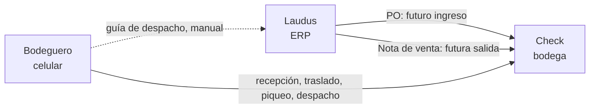

---
tags:
  - proyecto
estado: idea
sistemas:
  - Laudus
  - Check
  - Monday
  - Google Sheets
---

# Proyecto Bodega

Mapa del proyecto: qué es cada sistema, el vocabulario y los flujos que salen de aquí. El detalle de la cuadratura está en [[Cuadratura de bodega Laudus vs Check]].

## Objetivo

Que el stock de **Laudus** (ERP) y el de **Check** (bodega) coincidan, y entender por qué se descuadran cuando no lo hacen.

## Los dos mundos

- **Laudus**: padnumber + cantidad (físico, estimado, reservado). Solo el físico se compara con Check.
- **Check**: padnumber + ubicación + unidad de almacenamiento.
- Integración robótica y unidireccional: PO y notas de venta (Laudus → Check). La guía de despacho es manual y **no vuelve a Check**.

## Glosario

| Término | Significado |
| ------- | ----------- |
| Padnumber | Código del producto |
| Ubicación `P…` | Posición de pallet (P61, P62…) |
| Ubicación `E…` | Estantería, más pequeña (E001A, E001AB…) |
| Unidad de almacenamiento | Pallet o caja donde está el producto |
| A piso | Producto sin caja, normalmente porque saldrá de inmediato |
| Orden de recepción | Se crea desde una PO pendiente; el bodeguero la recibe en el celular |
| Orden de piqueo | Se crea desde una nota de venta; indica dónde buscar |
| Traslado | Movimiento físico de una ubicación a otra |
| Físico / estimado / reservado | Presente / entrada futura / salida futura (Laudus) |

## Bodegas

Principal · Erick · Recepción · Despacho · Servicio técnico

## Flujos y notas

- [[Cuadratura de bodega Laudus vs Check]]: comparar stock y listar diferencias (hoy en n8n, "ERICK CHECK").
- Pendiente de crear: cierre de salida en Check cuando hay guía de despacho en Laudus.
- Pendiente de crear: seguimiento diario de diferencias nuevas y resueltas.

## Preguntas abiertas

- [ ] ¿Cuándo un producto va "a piso" y cuándo en caja? Explica parte de las diferencias.
- [ ] ¿Qué cambió en los nombres de los elementos de bodega tras la pausa de Check?
- [ ] ¿Se puede automatizar la descarga de los dos reportes de stock?
- [ ] ¿Quién revisa las diferencias cada día y por qué canal se le avisa?

## Fuera de alcance por ahora

- Productos comprados en cajas de 10 y vendidos sueltos (romper la caja descuadra el stock).
- Comparar estimado y reservado.

## Dónde sacar los datos

- Laudus: *Herramientas → Estadísticas → Stock*
- Check: *Reportes → Stock → Bajar el Excel*
